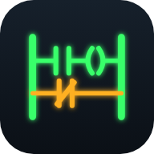
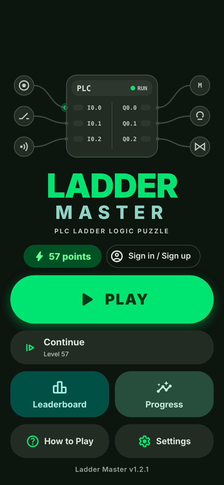
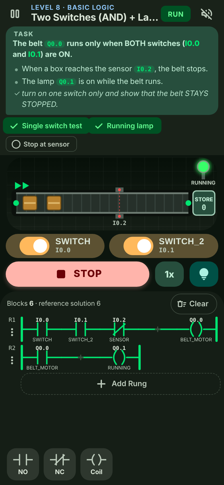
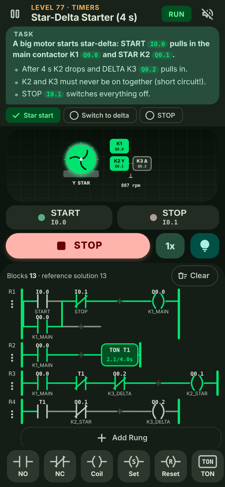
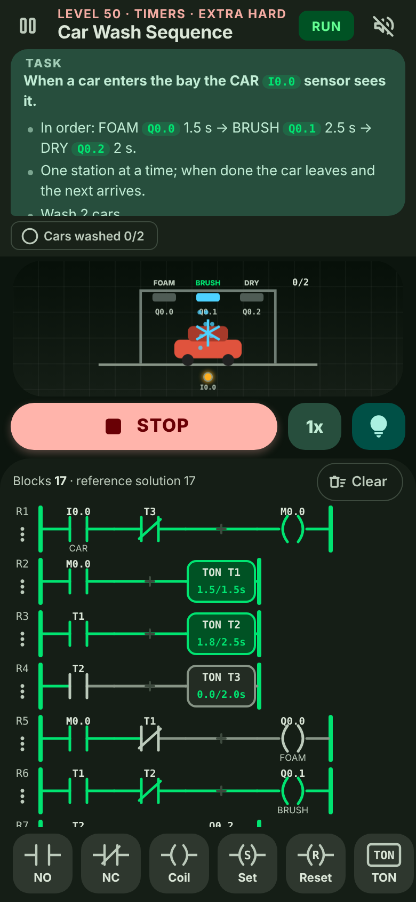
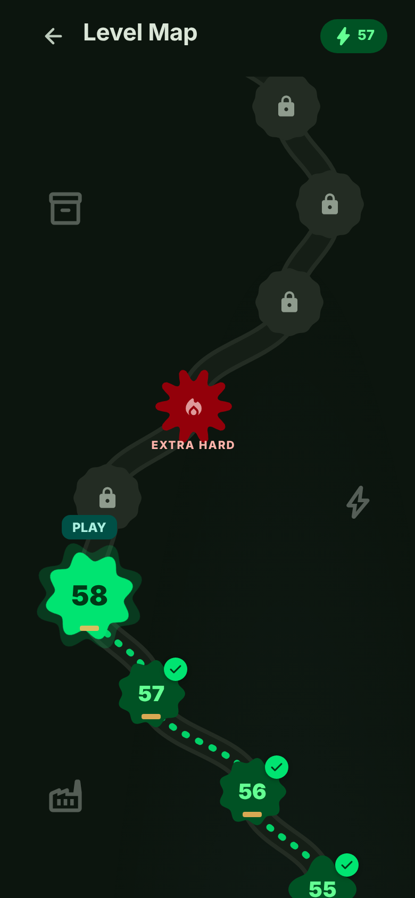
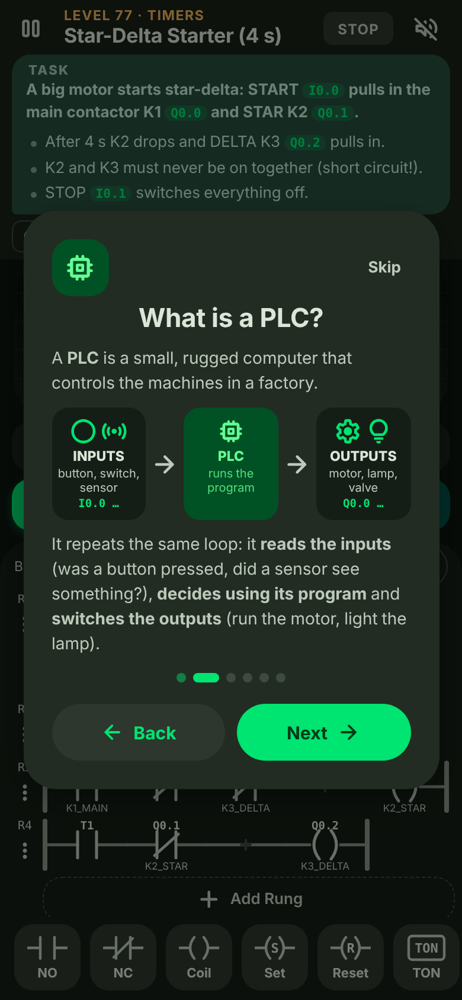

  

<h1 align="center">⚡ Ladder Master</h1>

  <b>A PLC ladder logic puzzle game for your phone.</b> 
  Program real factory machines — belts, motors, doors, lifts — and watch them come alive.

  
  &nbsp;
  
  &nbsp;
  

  
  
  
  

  <a href="#english">English</a> · <a href="#türkçe">Türkçe</a>

  
  
  
  

---

## 🇬🇧 English

### What is it?
**Ladder Master** teaches you how industrial machines are programmed — by playing. Every level is a small automation job: a conveyor that has to stop at a sensor, a motor that needs a star-delta start, a garage door with a safety photocell, a car park that counts its spaces. You build the program from ladder logic blocks, press **RUN**, and a live simulation shows whether your machine behaves.

No experience needed: a short intro explains what a PLC is, and every new instruction is introduced the first time a level needs it.

### 🎮 How it plays
1. **Read the task** — what should switch on, and when.
2. **Build rungs** — drag contacts and coils onto the ladder, left to right.
3. **Pick addresses** — inputs `I0.x`, outputs `Q0.x`, memory, timers, counters.
4. **Press RUN** — energised lines glow green, timers and counters tick live.
5. **Pass the goals** — each finished level is worth one point on the leaderboard.

### ✨ Highlights
| | |
|---|---|
| 🗺️ **10,000 levels** | One long road that gets harder step by step, with 🔥 extra-hard levels and rare 🎉 bonus levels. |
| 🏭 **Real machines** | Conveyors, pistons, filling and paint stations, tanks, ovens — plus motors, star-delta starters, forward/reverse hoists, garage doors, lifts, car parks, car washes, two-hand presses, greenhouses, pump stations and home alarms. |
| 🧠 **S7-200 style PLC** | Contacts, coils, Set/Reset, edge detection, timers (TON/TOF/TONR), counters (CTU/CTD), compare, move & math, shift, byte logic, 7-segment and real-time clock. |
| 📱 **Made for phones** | Drag & drop editor, haptics, spring animations, Material 3 Expressive design, light & dark themes. |
| ☁️ **Account & leaderboard** | Sign in to back up your solutions and compete. Scores are calculated on the server, so they can't be faked. |
| 📴 **Works offline** | Install it as an app; it runs without internet. |

### 📸 More screenshots

  
  

### ▶️ Play
**https://tunagirit.github.io/ladder-master/** — open it in your phone's browser and choose *Install app* to add it to your home screen.

---

## 🇹🇷 Türkçe

### Nedir?
**Ladder Master**, fabrikalardaki makinelerin nasıl programlandığını oynayarak öğreten bir **PLC ladder (merdiven) mantığı bulmaca oyunu**. Her bölüm küçük bir otomasyon görevi: sensörde durması gereken bir konveyör, yıldız-üçgen ile kalkması gereken bir motor, fotoselli bir garaj kapısı, boş yerlerini sayan bir otopark. Programı ladder bloklarıyla kurarsın, **RUN**'a basarsın, canlı simülasyon makinenin doğru çalışıp çalışmadığını gösterir.

Hiç bilmiyorsan sorun yok: kısa bir tanıtım PLC'nin ne olduğunu anlatır, her yeni komut da ilk kez gerektiği bölümde tanıtılır.

### 🎮 Nasıl oynanır?
1. **Görevi oku** — neyin, ne zaman çalışması gerektiği yazar.
2. **Satır kur** — kontakları ve bobinleri soldan sağa sürükle.
3. **Adres seç** — girişler `I0.x`, çıkışlar `Q0.x`, hafıza, zamanlayıcı, sayıcı.
4. **RUN'a bas** — enerjili hatlar yeşil yanar, zamanlayıcı ve sayıcılar canlı ilerler.
5. **Hedefleri tamamla** — her bölüm liderlik tablosunda bir puan.

### ✨ Öne çıkanlar
| | |
|---|---|
| 🗺️ **10.000 bölüm** | Adım adım zorlaşan tek bir yol; arada 🔥 ekstra zor ve nadir 🎉 bonus bölümler. |
| 🏭 **Gerçek makineler** | Konveyör, piston, dolum ve boya istasyonu, tank, fırın — ayrıca motor, yıldız-üçgen, ileri-geri vinç, garaj kapısı, asansör, otopark, oto yıkama, çift el pres, sera, pompa istasyonu ve ev alarmı. |
| 🧠 **S7-200 tarzı PLC** | Kontak, bobin, Set/Reset, kenar algılama, zamanlayıcılar (TON/TOF/TONR), sayıcılar (CTU/CTD), karşılaştırma, taşıma ve matematik, kaydırma, bayt mantığı, 7-segment ve gerçek zaman saati. |
| 📱 **Telefon için** | Sürükle-bırak editör, titreşim, yaylı animasyonlar, Material 3 Expressive tasarım, açık ve koyu tema. |
| ☁️ **Hesap ve liderlik** | Giriş yap, çözümlerin yedeklensin, sıralamada yarış. Puan sunucuda hesaplanır, sahtesi yapılamaz. |
| 📴 **İnternetsiz çalışır** | Uygulama olarak yükle, internet olmadan da oyna. |

### ▶️ Oyna
**https://tunagirit.github.io/ladder-master/** — telefonunun tarayıcısında aç, *Uygulamayı yükle* ile ana ekrana ekle.

---

  © 2026 tunagirit · <b>All rights reserved / Tüm hakları saklıdır.</b> 
  The source is public for viewing only — see <a href="LICENSE">LICENSE</a>. · Kaynak kodu yalnızca incelenmek için açıktır — <a href="LICENSE">LICENSE</a>.

